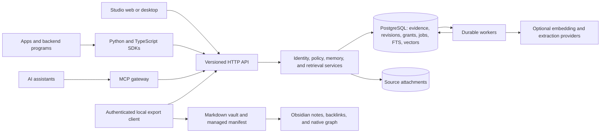

# Proposed Mnemion v4 architecture

[Study overview](README.md) · [Evidence](EVIDENCE.md) · [Roadmap](ROADMAP.md)

This is an implementation blueprint, not a description of deployed functionality. It assumes a self-hostable service for small application teams initially, with a path to managed hosting. Scale, hosting budget, and required identity providers have not been specified. **Obsidian visualization is a required client integration from the first migration milestone.**

## Product boundary

Mnemion accepts evidence and memory from applications, authorizes access, preserves changes, and returns relevant context with citations. An assistant, desktop program, backend service, or team member can use the same contract. Agent orchestration, model training, task delegation, and a proprietary vector database are outside the initial core.

Start with a modular Python service using FastAPI/Pydantic, PostgreSQL, pgvector, and PostgreSQL full-text search. PostgreSQL owns canonical records, revisions, permissions, and durable jobs. Large source attachments can use a filesystem or S3-compatible object store behind one blob interface. Keep extraction and model adapters optional. Keep React Studio as the administration client and retain useful Electron lifecycle work as a desktop client or local launcher.

PostgreSQL reduces the number of independent consistency boundaries compared with a vector store plus an unrelated truth database. It does not automatically solve tenancy, asynchronous indexing, or model quality. Those contracts must be implemented explicitly.

Use a modular monolith with separate worker processes first. This gives transactions and shared policy code without introducing a distributed service mesh. A single-container or Compose quickstart can package the components for development. Embedded SQLite may later be a supported single-user mode; maintaining two equally capable production engines is outside the first team release. The v3 importer remains a separate compatibility adapter.

## Domain and identity

| Concept | Contract |
| --- | --- |
| Organization / tenant | Isolation and ownership boundary established by authenticated credentials |
| Principal | A human, application, or service account performing an action |
| Subject | The person, entity, project, or application object a memory describes; it does not confer access |
| Space | A project or collection with explicit grants; private spaces support personal memory |
| Source and source revision | Captured evidence and its immutable revisions, retained until authorized purge |
| Memory and memory revision | A durable address and versioned content or claim supported by source spans |
| Event | A recorded occurrence, with source time, recorded time, actor, and application/session identifiers |
| Claim | A sourced assertion with validity interval and correction/supersession relationships |
| Core block | Small, explicitly editable working context with a scoped key and concurrency control |
| Projection | Embeddings, summaries, graph edges, profiles, wiki pages, and exports derived from identified revisions |

A service account writing about customer Alice is not Alice. An `added_by` string is not authenticated writer identity. An external assistant's display name is not a cross-system identity key. Map verified external identities through `(issuer, subject)` and explicit memberships; do not merge people automatically because names match.

Derive tenant and principal from the credential or validated delegated-user token. A body parameter cannot select an arbitrary tenant. Resolve each requested space against that principal's grants. Start with reader, contributor, reviewer, and administrator roles per space; contributors can propose changes, while sensitive publication or conflict resolution can require reviewer authority. Keep permission to manage credentials distinct from unrestricted application access.

Initially each record belongs to one space. Sharing between spaces is an explicit publish operation that creates an authorized evidence snapshot in the destination. If a private source supports a shared claim, publish the permitted excerpt or withhold it; never leak the private source through citations, titles, entity names, counts, or summaries. Cross-space recall composes only spaces the caller can access.

Apply scope to every table and output: sources, chunks, claims, graph edges, core blocks, jobs, caches, search candidates, evidence fetches, exports, and telemetry. Use PostgreSQL row-level security as defense in depth, a non-owner application role without bypass privileges, composite tenant/space foreign keys, and transaction-local identity context. Test connection-pool reuse so one request cannot inherit another request's scope. Workers and administrative jobs need explicit, audited scope as well.

## Data model and truth lifecycle

A practical initial schema includes `tenants`, `principals`, `external_identities`, `spaces`, `space_grants`, `sources`, `source_revisions`, `source_chunks`, `memories`, `memory_revisions`, `claim_evidence`, `claim_relations`, `core_blocks`, `core_block_revisions`, `embedding_generations`, `embeddings`, `outbox_jobs`, `deletion_receipts`, `projection_manifests`, and `audit_events`. Split these into modules according to behavior rather than expose every table as an independent public API.

Use stable UUIDs and scoped legacy-ID aliases. Uniqueness and deduplication must include the relevant tenant/space boundary. Identical content in two spaces must not leak through global deduplication or a shared ID. Store content hashes, source offsets, source revision, extractor version, and producing model/configuration for derived records.

Keep these axes separate:

- **Access:** who may read or change the record.
- **Review:** ordinary, restricted, or quarantined processing state.
- **Claim lifecycle:** observed, verified, contested, superseded, or retracted.
- **Time:** source event time, valid-from/valid-to, and recorded-at/known-at.
- **Relevance:** a retrieval score with a named scoring method.

An unverified statement can be current and still uncertain. A search score is not a truth probability. An LLM may suggest a contradiction or a new claim, with evidence; it must not silently become the authority for demoting a team's approved decision. Retain competing claims and their provenance, and expose ambiguity when the evidence cannot resolve it.

Evidence revisions are append-only during retention, with an explicit purge path. “Immutable” must not mean undeletable personal information. Deletion records can retain non-content identifiers required to prevent resurrection while source bytes and derived content are purged according to policy.

## Ingestion and consistency

Every entry point calls the same application service: SDK, MCP, CLI, assistant hook, folder watcher, future webhook, migration importer, and Studio. None writes directly to a vector collection or sidecar.

1. Authenticate, authorize, validate size/type, and resolve source identity.
2. Accept an idempotency key scoped to principal/tenant/space and store a payload hash. Reusing the key with a different payload returns a conflict.
3. In one PostgreSQL transaction, write source/memory revisions, immediately searchable text, audit information, and outbox jobs.
4. Return an operation ID and a precise state: `accepted` means durable canonical data; `indexed` means the selected search generation is ready.
5. Workers claim jobs with leases, retries, and dead-letter status. Use short database transactions with `FOR UPDATE SKIP LOCKED`; do not hold a transaction open during model calls.
6. Each projection write is idempotent on source revision and pipeline version. An older job cannot overwrite a projection for a newer revision. Mark completion with the same durable job state.

Delivery is at least once. Correctness comes from idempotent transitions, not an “exactly once” label. A worker crash after producing an embedding but before acknowledgment must be safe to retry. Quotas, backpressure, retry limits, and cancellation prevent one tenant's large import from monopolizing the service.

Blob storage requires a separate protocol: stage a checksummed object, commit its reference with the source revision, and clean unreferenced staged objects later. Do not imply a PostgreSQL transaction also commits an object store atomically. Reject or visibly flag missing blobs during recovery.

Offer a read-after-write option using an operation ID or index watermark. A caller can wait for the relevant index generation or accept a response that clearly reports incomplete semantic indexing. Keyword retrieval can remain available immediately after the canonical transaction. A successful write must never mean “one of several stores probably contains the ID.”

## Retrieval and context assembly

The retrieval pipeline is:

1. Resolve authorized spaces, subjects, source types, and temporal constraints.
2. Retrieve lexical and dense candidates within that scope; retain a deterministic exact/lexical baseline for evaluation.
3. Fuse ranked candidates; optionally rerank a bounded set. Apply weighting before final sorting and truncation. Name the scores instead of calling every score similarity.
4. Expand through a bounded, scoped graph only when helpful. Each graph assertion carries evidence and a validity interval.
5. Recheck live authorization, deletion, source revision, and review state for all hydrated content and citations. A stale summary cannot restore access to withdrawn evidence.
6. Deduplicate, enforce a real token budget, and return context with citations, timestamps, warnings, and an index watermark.

PostgreSQL approximate-vector filtering needs explicit tests: selective tenant/space filters can affect candidate count and recall. Use supported iterative scans, scoped partitions/indexes, or exact fallback as appropriate to the measured workload. Authorization must never depend on filtering a large unauthorized result set after it has been exposed to a model or caller.

Provide a fast evidence-recall path and a separate optional reflect/synthesize path. Expose profile/core blocks, episodic events, semantic claims, approved procedures, and task context with distinct purposes and retention. Expensive profile/wiki consolidation runs as versioned background work. Retrieval should abstain or surface a conflict when evidence is insufficient.

Store an embedding fingerprint including model, revision, dimensions, normalization, preprocessing/chunking, and query/document prompt configuration. Changing that fingerprint creates a new generation. Build and compare the new generation before switching; do not mix incompatible vectors. Keep hash embeddings confined to tests and defer learned grooming/prediction until held-out ablations show an advantage.

English and French queries, accented terms, exact identifiers, and cross-language retrieval belong in the initial evaluation. Regex extraction and English-only token assumptions are insufficient for a general application memory service.

## Application API and MCP

Publish an OpenAPI contract with typed Python and TypeScript clients. Clients should configure endpoint, credentials, timeouts, and retry policy once. Use opaque cursor pagination, stable error codes, bounded request sizes, API versioning, and explicit deprecation periods.

| Endpoint | Essential behavior |
| --- | --- |
| `POST /v1/spaces/{space_id}/memories` | Accept source text or an authorized source reference, subject/session metadata, and an idempotency key; return memory/revision/operation IDs |
| `GET /v1/operations/{operation_id}` | Report accepted/indexing/ready/failed/cancelled status, with authorized error details |
| `POST /v1/recall` | Scoped evidence retrieval with time filters, result/token budget, citations, and scoring metadata |
| `GET /v1/memories/{memory_id}` | Fetch an authorized record and optionally a permitted revision; apply the same policy as search |
| `POST /v1/memories/{memory_id}/revisions` | Propose or apply a sourced correction using `If-Match`/expected revision |
| `DELETE /v1/memories/{memory_id}` | Commit denial from future reads and return a deletion receipt with projection-purge status |
| `POST /v1/context` | Assemble authorized core blocks, profile, and query evidence within a token budget; expose freshness and omissions |
| `GET/PUT /v1/spaces/{space_id}/blocks/{key}` | Read/update working context with version checks; reject lost updates |
| `POST /v1/exports` | Produce a scoped versioned archive or Obsidian manifest and files; no arbitrary server filesystem destination |

Separate operational/admin endpoints from ordinary application credentials. Model settings should return `configured: true` and a secret reference, not a raw provider key. Future outbound webhooks need authenticated subscriptions, replayable event IDs, and retry semantics; they are not necessary to prove the first vertical slice.

A recall result should identify `memory_id`, `revision_id`, `space_id`, `text`, `evidence`, `valid_time`, `recorded_at`, `claim_status`, `review_state`, `relevance_score`, and `score_method`. The response should also include `request_id`, an index watermark, warnings, and whether a requested budget or consistency condition limited the result. Evidence objects identify source revision and span; fetching them enforces the same current policy.

Use a maintained MCP implementation with negotiated protocol support and stdio/Streamable HTTP transports as appropriate. The gateway calls the same domain API as the SDKs. A proposed ordinary agent surface has six operations: `memory_save`, `memory_search`, `memory_fetch`, `memory_context`, `memory_revise`, and `memory_forget`. Tool schemas stay typed; a generic executable query language is unnecessary. Expose administrative operations only through an appropriate credential/tool profile.

Keep existing Mnemion and Open Brain aliases through a compatibility adapter for a documented transition period. Preserve legacy IDs through the alias map. Client instructions must accurately state whether capture hooks are installed, what is captured, and how startup context is supplied; registration of an MCP server alone cannot guarantee these behaviors.

## Obsidian visualization contract

Obsidian is a supported view of Mnemion's memory and evidence. Standard Markdown, YAML properties, wikilinks, backlinks, tags, and native graph navigation must work without a required community plugin. An optional plugin may later add live status, refresh, or a query panel, but the exported vault remains useful on its own.

Retain the existing `obsidian status/setup/sync/open` workflows and Studio's create/refresh/open/ZIP actions through compatibility commands. The local exporter authenticates to the service and writes a configured local vault. Remote servers return export artifacts; they do not attempt to open or edit the user's desktop files.

Preserve existing `Mnemion.md`, `Wings/...`, `Trust/...`, `Entities/...`, `_Mnemion/Cognitive Graph.md`, `_Mnemion/Memory Guard.md`, and `_Mnemion/Compiled Wiki/...` paths during migration. An export manifest maps canonical IDs and legacy IDs to stable note paths. Renaming an entity or moving a memory changes its display metadata without needlessly breaking existing links. Where ambiguity requires a new note, retain an alias or link note and report the change.

| Exported object | Obsidian representation |
| --- | --- |
| Memory/event/claim | A Markdown note with stable ID, readable text, status, timestamps, and links to its source and related entities |
| Source and evidence | Source note and stable span/block identifiers; citations link to readable excerpts and provenance |
| Entity/project | Index note with backlinks to authorized memories and source relationships |
| Space/wing/room | Existing navigation indexes, with additional space metadata where needed |
| Correction or dispute | A readable relationship between versions/claims, with current status and evidence |
| Compiled knowledge | Generated sections with source links and an explicitly preserved manual section |

Keep legacy properties such as `id`, `wing`, `room`, and `trust_status` where existing workflows rely on them, and add explicit `mnemion_id`, `mnemion_schema`, `source_revision`, and claim/review metadata. Properties must be valid YAML and paths must be portable across Windows, WSL, Linux, and macOS. Test accents, duplicate titles, case-insensitive collisions, reserved Windows names, and long paths.

Native Obsidian graph edges come from real wikilinks. Relationship type, evidence, and time belong in note text/properties or relationship notes; do not assume the native graph interprets an arbitrary typed-edge JSON file. Provide useful indexes and tags for navigation instead of creating links between every vaguely similar memory.

The refresh protocol must preserve human work:

1. Maintain `.mnemion-obsidian-manifest.json` with format version, scope, stable path mapping, last generated hashes, and a completed export watermark. Keep the compiled-wiki manifest readable or migrate it explicitly.
2. Generate into a staging area, validate all paths and links, and write files atomically. Only advance the completed watermark after a successful refresh; interrupted work must be resumable.
3. Replace known generated sections between markers. Preserve manual sections byte-for-byte. For an existing full-file export that has been edited, create a conflict/diff artifact and retain the edited original until resolved; never silently decide that it is disposable.
4. Prune only previously managed files whose current state is safe to remove. Preserve unmanaged notes and `.obsidian` settings. A removed managed file with annotations requires an explicit archival/conflict path governed by the destination's policy.
5. Re-evaluate access, deletion, quarantine, and sensitive-source export policy. Ordinary team views contain permitted evidence; an authorized review export can separately show quarantined material. Do not conflate an owner review vault with a shared team vault.

Mnemion remains authoritative for shared memory. Local annotations are preserved as annotations; importing a note or proposed correction into shared memory is a separate authenticated action with evidence and conflict checks. This avoids turning Obsidian Sync or a Git merge of Markdown into an accidental database replication protocol.

A local export is a materialized copy: revocation affects future service access immediately, while a managed local copy is updated on its next authorized refresh. Already copied or manually redistributed files cannot be recalled by the service. Record export time, scope, and policy so the user can distinguish a current view from an offline snapshot.

Compatibility gates include a copied v3 vault upgraded without broken existing links, repeat refresh without losing annotations, scoped and trust-aware export, deletion handling, a recoverable interrupted refresh, and a manual native Obsidian graph check. These are first-release requirements.

## Deletion, recovery, and operations

Deletion first commits an authoritative deny/tombstone state. New search, graph, profile, wiki, evidence, and export requests after that commit must honor it, regardless of projection lag. Define behavior for requests already in flight explicitly. Durable jobs then remove derived copies, cached context, vector rows, and blobs; a receipt tracks completion and failures. Keep retention and backup expiry explicit. A restored snapshot must replay or reconcile the current deletion ledger before it becomes readable, so old backups cannot resurrect withdrawn records.

Produce complete recovery archives with schema version, application version, source/revision counts, hashes, attachment inventory, grants, review/trust history, deletion state, core blocks, and projection generation metadata. Treat embeddings and wiki pages as rebuildable while preserving their provenance and any manual content. Validate the entire archive and stage a restore before publishing it. Partial parsing must fail visibly.

Expose readiness separately from process liveness. Record request IDs, operation IDs, per-tenant queue depth/age, index watermark, failed jobs, model latency/cost, recall latency, and restore status. Logs should omit raw memory text and secrets by default. Export metrics that explain why a save is accepted but indexing remains pending.

The operator console should prioritize spaces and credentials, ingestion failures, source/evidence inspection, query explanations, conflict review, Obsidian export health, deletion receipts, and backup verification. “Connected” should describe a reachable service; it should not imply every memory projection is current.

Before a production pilot, define target workload and hardware, then set service objectives for durable acknowledgment, warm/cold recall, indexing lag, restoration time, and cost per successful task. Provisional targets belong in a measured benchmark configuration, not product claims. Add managed hosting, high availability, or another retrieval backend only after the initial contract and workloads justify them.
